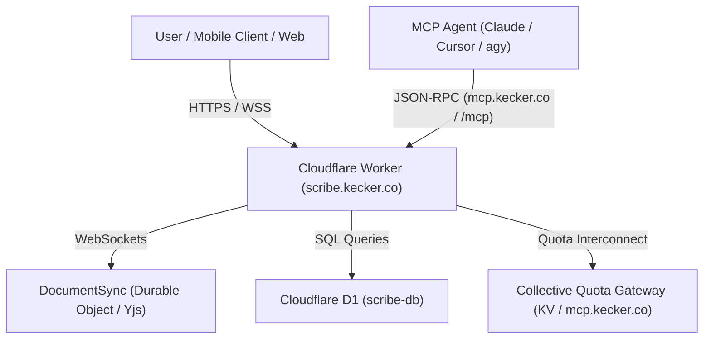

# Scribe Architecture Overview

Scribe is the collaborative rich-text and Markdown document editing engine for the Kecker ecosystem, accessible at `https://scribe.kecker.co`. It combines low-latency CRDT document synchronization (powered by Yjs and Cloudflare Durable Objects) with relational persistence in Cloudflare D1 and secure MCP tool integration.

## Problem Statement & Value Proposition

Traditional document systems force a trade-off between seamless real-time collaborative editing and robust offline/mobile synchronization. Scribe resolves this by combining:
1. **CRDT Collaboration**: Real-time multi-client editing via `DocumentSync` Durable Objects executing WebSockets and Yjs binary state vectors.
2. **Deterministic Edge Persistence**: Cloudflare D1 relational storage for documents, metadata, revisions, and organization workspaces.
3. **Multi-App Collective Quota Enforcement**: Real-time quota tracking under a collective 50 MB storage envelope shared across all Kecker Office apps (`scribe`, `pointless`, `base`, `ovrwhlm`).
4. **Obfuscated Share Links**: Secure public document URLs with non-enumerable user identifiers.
5. **AI Agent Tooling**: Native MCP server (`SCRIBE_MCP`) allowing autonomous coding assistants to read, author, and mutate documents safely.

