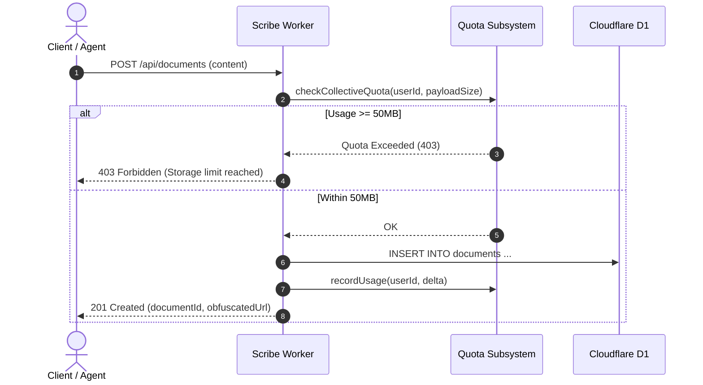

# Scribe Core Workflows

## 1. Document Creation & Collective Quota Gating

Before any document or attachment is written to D1:
1. Scribe extracts the user identifier (`sub` from Kinde JWT or legacy session).
2. Scribe queries the collective storage usage across all 4 Kecker Office apps (`checkCollectiveQuota`).
3. If `currentBytes + payloadBytes > 50 MB`, the write is rejected immediately with `HTTP 403 Storage Quota Exceeded`.
4. If allowed, the document is inserted into D1 and the user's storage usage is reported back to the unified quota ledger.

## 2. Collaborative Editing Session

1. Client opens WebSocket connection to `/api/documents/:id/sync`.
2. Worker routes WebSocket to `DocumentSync` Durable Object matching `:id`.
3. Durable Object loads Yjs document snapshot from local DO SQLite storage or initializes fresh.
4. Clients exchange incremental Yjs sync steps (`sync-step-1`, `sync-step-2`, update vectors).
